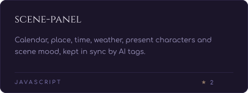
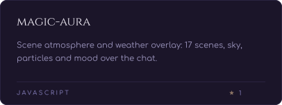
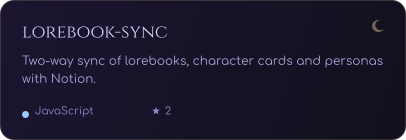
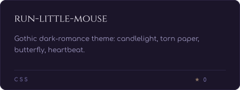
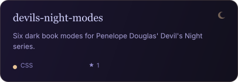
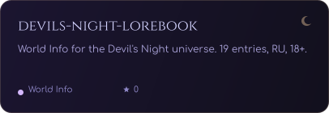

  

  
  
  
  

I build the quiet machinery under the roleplay: scene state, weather, calendars, memory. Extensions, themes and lorebooks for **SillyTavern**.

Everything here is made for long nights and slow stories — candlelight instead of dashboards, atmosphere instead of noise.

---

### Extensions

  

  

### Themes

  

### Lorebooks

  

---

  
  

  Selena's Tavern · built between midnight and three · <a href="https://github.com/satsvi97?tab=repositories">all repositories</a>

