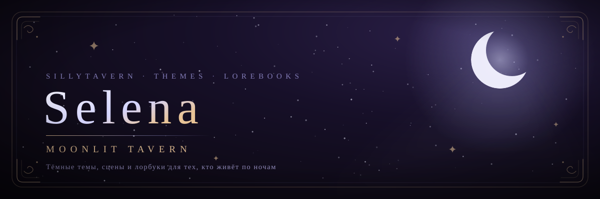

  

  
  
  
  

I build the quiet machinery under the roleplay: scene state, weather, calendars, memory. Extensions, themes and lorebooks for **SillyTavern**.

Everything here is made for long nights and slow stories — candlelight instead of dashboards, atmosphere instead of noise.

---

### Extensions

| Project | What it does |
|:--|:--|
| **[scene-panel](https://github.com/satsvi97/scene-panel)** | Calendar, place, time, weather, present characters, open threads and scene mood — kept in sync by AI tags. |
| **[magic-aura](https://github.com/satsvi97/magic-aura)** | Scene atmosphere and weather overlay: 17 scenes, sky, particles and mood above or under the chat. |
| **[lorebook-sync](https://github.com/satsvi97/lorebook-sync)** | Two-way sync of lorebooks, character cards and personas with Notion. |

### Themes

| Project | What it does |
|:--|:--|
| **[run-little-mouse](https://github.com/satsvi97/run-little-mouse)** | Gothic dark-romance theme: candlelight, torn paper, butterfly, heartbeat. |
| **[devils-night-modes](https://github.com/satsvi97/devils-night-modes)** | Six book modes for Penelope Douglas' *Devil's Night* series — Corrupt, Hideaway, Kill Switch, Punk 57, Conclave, Nightfall. |

### Lorebooks

| Project | What it does |
|:--|:--|
| **[devils-night-lorebook](https://github.com/satsvi97/devils-night-lorebook)** | World Info for the *Devil's Night* universe — 19 entries, RU, 18+. |

---

  
  

  ☾ Moonlit Tavern · built between midnight and three · <a href="https://github.com/satsvi97?tab=repositories">all repositories</a>

